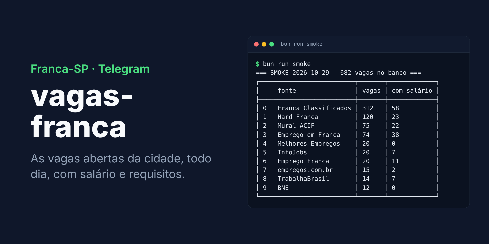
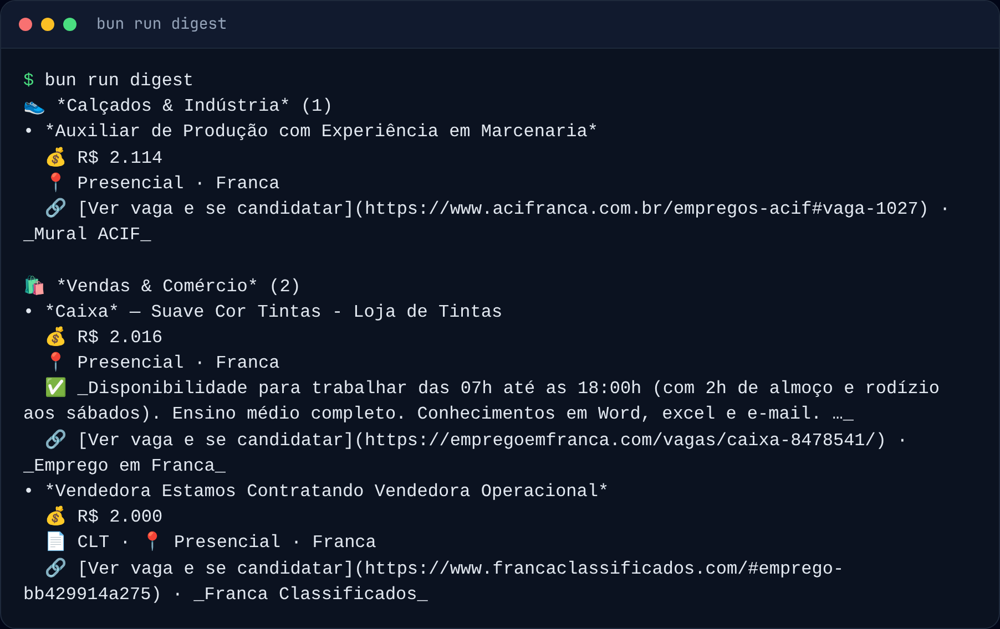
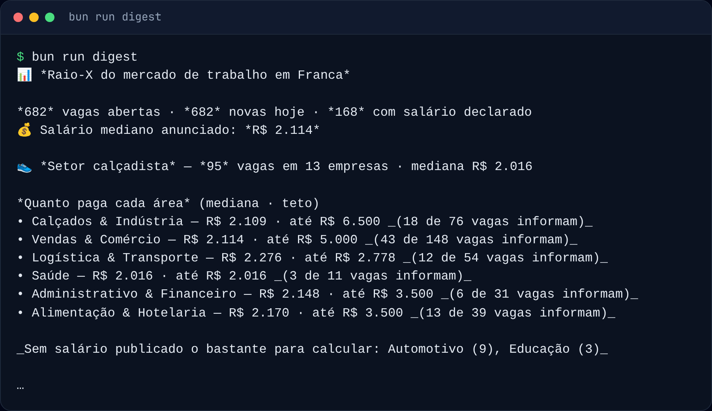
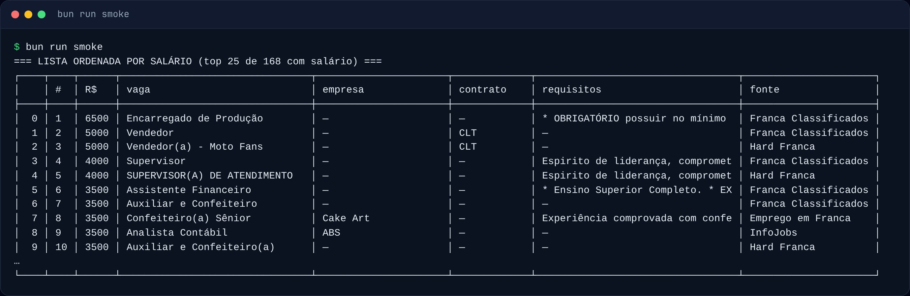
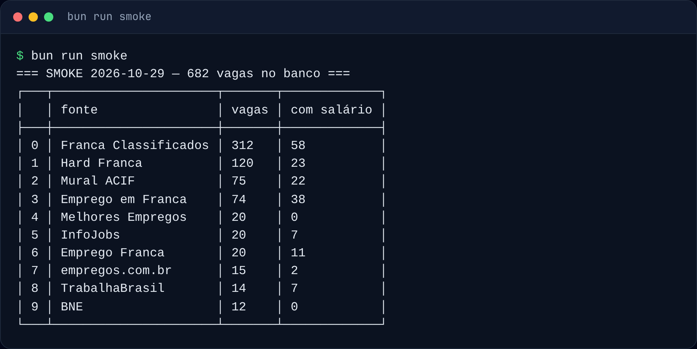
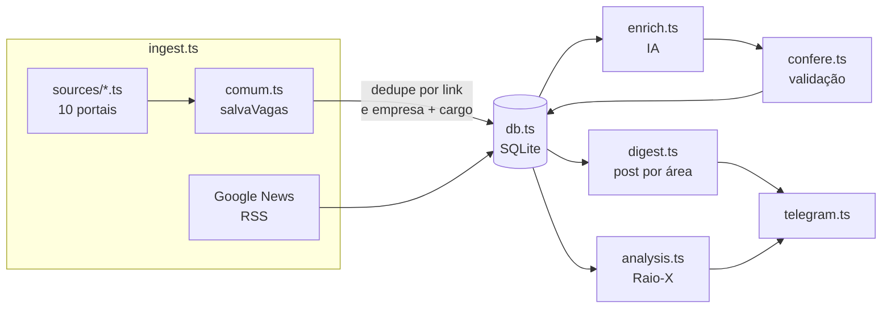

<div align="center">


# vagas-franca

**Bot de Telegram que publica todo dia as vagas de emprego abertas em Franca-SP.**<br/>
Uma coleta rápida traz cerca de 680 vagas de 10 fontes em 2,5 minutos, com salário, contrato e requisitos lidos do próprio anúncio.

[](https://bun.sh)
[](https://www.typescriptlang.org)
[](https://www.sqlite.org)
[](https://core.telegram.org/bots)


<br/>



</div>

> **Todo dia no Telegram: as vagas abertas de Franca, agrupadas por área, com salário, contrato, requisitos e o link para se candidatar.**
> Para ver funcionando: `DB_PATH=/tmp/vagas.db bun run smoke`. Sem token do Telegram o post sai no console; sem IA ele sai igual, só com os salários que os portais informam.

## 💡 Por que

O escopo é pequeno de propósito: **vagas de Franca e microrregião, publicadas no Telegram**. Não é um portal de candidatura e não tem interface web.

🔎 **Muitas fontes, uma lista.** Portais nacionais e murais locais (ACIF, classificados, RH de empresas) entram no mesmo banco, sem repetir a vaga: dedupe por link e por empresa + cargo. [Cada fonte](docs/fontes.md).

💰 **Salário só quando o texto diz.** Valor rotulado como salário, entre R$ 800 e R$ 30.000; benefício, comissão e preço soltos não contam. A IA lê só o que sobrou e nada que ela devolve é publicado sem passar por validação contra o texto. [Como](docs/parsers-e-ia.md).

📬 **Nada se perde em silêncio.** Uma vaga só é marcada como publicada depois que o Telegram confirma o envio; se o envio ou a IA cair, ela volta na fila do próximo post.

🧭 **Diz o que não cobre.** Não existe lista oficial das vagas da cidade; os [limites](docs/fontes.md#cobertura-e-limites) estão escritos, não escondidos.

## 🖼️ Tour

<table>
<tr>
<td><br/><b>Post por área</b> (<code>bun run digest</code>) &ndash; salário, contrato, requisitos (✅) e link de cada vaga.</td>
</tr>
<tr>
<td><br/><b>Raio-X do mercado</b> &ndash; vagas abertas, salário mediano e quanto paga cada área; calculado em SQL, sem IA.</td>
</tr>
<tr>
<td><br/><b>Lista por salário</b> (<code>bun run smoke</code>) &ndash; as vagas mais bem pagas do que foi coletado.</td>
</tr>
</table>

<details>
<summary>🗂️ Fontes coletadas na mesma rodada</summary>



</details>

<sub>Capturas de 29/10/2026 da saída real dos comandos (`PAGES_PER_BOARD=1`); o contato das empresas foi retirado do post e as linhas omitidas aparecem como `…`. Para regenerar: `scripts/readme-screenshots.mjs`.</sub>

## 🚀 Início rápido

Requer [Bun](https://bun.sh) (testado com 1.4.4). Verificado num checkout limpo em 29/10/2026.

```bash
git clone https://github.com/juninmd/vagas-franca.git && cd vagas-franca
bun install --frozen-lockfile    # dependências
cp .env.example .env             # configuração (nada é obrigatório para testar)

# coleta ao vivo num banco descartável (~2,5 min, ~680 vagas)
DB_PATH=/tmp/vagas.db PAGES_PER_BOARD=1 INFOJOBS_FILTROS=0 bun run smoke

# imprime o post de hoje no console, sem TELEGRAM_BOT_TOKEN
DB_PATH=/tmp/vagas.db bun run digest
```

> [!NOTE]
> O `smoke` grava no banco e por isso **recusa rodar** sem `DB_PATH` ou com `./data/store.db`. Para publicar de verdade, preencha `TELEGRAM_BOT_TOKEN` e `TELEGRAM_CHAT_IDS` no `.env` e rode `bun run dev`.

## ▶️ Uso

`bun run ingest` coleta de todas as fontes e termina; cada linha é uma fonte:

```text
  [empregoemfranca] 74 vagas (74 novas)
  [hardfranca] 120 vagas (120 novas)
  [trabalhabrasil] 15 vagas (14 novas, 1 já vistas em outro portal)
```

`bun run digest` enriquece a fila do dia com a IA (se houver provedor), publica o post por área e depois o Raio-X. Com `bun start` o bot fica de pé e dispara os dois pelos horários de `CRON_INGESTION` e `CRON_DIGEST`.

## 🧩 Como funciona



- **Estado só avança com envio confirmado.** `posted`, `digested`, `snapshots` e `enriched` mudam depois da confirmação, nunca antes. [Detalhe](docs/parsers-e-ia.md#entrega-nada-é-marcado-sem-ter-saído).
- **Regra antes de IA.** `format.ts` extrai salário rotulado, contrato e requisitos por regra fechada; a IA só preenche o que sobrou.
- **Coleta educada.** Detalhes são abertos em série e com pausa; o BNE para no primeiro 403/429; vaga descartada por idade é lembrada por uma semana.
- **Fonte que cai não derruba as outras.** Cada coleta é independente e o erro é só registrado.

## ⚙️ Configuração

Tudo por variável de ambiente (o Bun lê o `.env` sozinho). Modelo completo em [`.env.example`](.env.example).

| Variável | Para quê | Obrigatório / padrão | Exemplo |
|---|---|---|---|
| `TELEGRAM_BOT_TOKEN` | token do bot; vazio imprime no console | vazio | `123456:ABC...` |
| `TELEGRAM_CHAT_IDS` | chats que recebem o post, separados por vírgula | vazio | `123456789` |
| `DB_PATH` | banco SQLite: dedupe, "já postei", histórico | `./data/store.db` | `/data/store.db` |
| `AI_PROVIDER` | `litellm` \| `ollama` \| `openai` \| `anthropic` \| `google` | `litellm` | `ollama` |
| `LITELLM_BASE_URL`, `LITELLM_API_KEY`, `LITELLM_MODEL` | provedor padrão | cluster interno | — |
| `OLLAMA_BASE_URL`, `OLLAMA_MODEL` | IA local | `localhost:11434`, `llama3.2` | — |
| `OPENAI_API_KEY`, `ANTHROPIC_API_KEY`, `GEMINI_API_KEY` (+ `*_MODEL`) | provedores em nuvem | vazio | — |
| `CRON_INGESTION` | coleta de 6 em 6 horas | `0 */6 * * *` | — |
| `CRON_DIGEST` | post diário, 8h BRT | `0 11 * * *` | — |
| `CRON_TZ` | fuso das expressões de cron | `UTC` | `America/Sao_Paulo` |
| `JOBS_PER_DIGEST` | teto de vagas por post; o resto sai nos dias seguintes | `60` | `6` |
| `ENRICH_MAX_JOBS` | teto de vagas mandadas à IA por rodada | `120` | — |
| `PAGES_PER_BOARD` | páginas varridas por portal HTML | `5` | `1` |
| `INFOJOBS_FILTROS` | filtros públicos do InfoJobs abertos por rodada (a página expõe ~90) | `120` | `0` |
| `DETAIL_PAGES` | detalhes abertos por rodada, por portal (o BNE usa `× 3`) | `12` | — |
| `JOB_TTL_DAYS` | vaga não revista há tanto tempo é considerada encerrada | `21` | — |
| `TELEGRAM_INTERVAL_MS` | espaçamento entre mensagens (o Telegram corta em ~20/min por grupo) | `3500` | — |
| `AI_TIMEOUT_MS` | teto por chamada de IA | `60000` | — |

## 🛠️ Desenvolvimento

Testado com Bun 1.4.4. Comandos executados num checkout limpo, exceto onde indicado.

```bash
bun install --frozen-lockfile    # dependências
bun test                         # ~220 testes, sem rede (1 falha anterior em db.test.ts, ver abaixo)
bun run typecheck                # tsc --noEmit
bunx biome ci .                  # lint e formatação como na CI (só confere)
bun run lint                     # Biome corrigindo os arquivos (--write)
bun run ingest                   # só coleta; termina com código 0 (~1 min com PAGES_PER_BOARD=1)
bun run digest                   # só publica; sem token imprime no console
bun run dev                      # um ciclo: coleta + digest (não executado como um comando só)
bun start                        # loop com cron (processo contínuo; não executado aqui)
DB_PATH=/tmp/vagas.db bun run smoke                      # coleta ao vivo e imprime fontes, top 10 e lista por salário
DB_PATH=/tmp/vagas.db node scripts/readme-screenshots.mjs # regenera as imagens do README (~3 min; precisa do pacote playwright)
```

`bun test` termina com 1 falha anterior a este trabalho, em `tests/db.test.ts` ("banco somente-leitura derruba o boot"): o processo filho morre com `no such column: area` em vez da mensagem `readonly` que o teste espera. Falha também fora de root (verificado como `nobody`); os outros testes passam.

Docker: `docker build -t vagas-franca . && docker run -d -v vagas:/data -e TELEGRAM_BOT_TOKEN=... -e TELEGRAM_CHAT_IDS=... vagas-franca`. O volume em `/data` guarda o banco; sem ele cada deploy reposta tudo. Esses comandos não foram executados: o ambiente em que este README foi escrito não tinha o daemon do Docker.

## 🤝 Contribuindo

Mensagens de commit seguem Conventional Commits (`feat:`, `fix:`, `docs:`, `ci:`), como no histórico. O padrão dos workflows e a label `do-not-merge` (impede o merge automático) estão no [`AGENTS.md`](AGENTS.md).

## 📚 Documentação

| Documento | O que tem |
|---|---|
| 🔎 [Fontes](docs/fontes.md) | cada portal, como é coletado, cobertura, limites e armadilhas já investigadas |
| 🧪 [Parsers e IA](docs/parsers-e-ia.md) | regras de salário, contrato e requisitos; entrega confirmada; o que a IA faz e como é validada |
| 📊 [Raio-X e post](docs/raio-x-e-post.md) | a análise do mercado e o formato do post |
| 🤖 [AGENTS.md](AGENTS.md) | instruções para agentes e padrão dos workflows |

## 🔒 Segurança

O texto das vagas é escrito por terceiros e vira mensagem no Telegram; cada camada trata isso.

| Camada | Proteção |
|---|---|
| Saída da IA | `src/confere.ts`: o número precisa existir no texto como token e ter forma de salário, jornada ou benefício conhecido |
| Links | `linkSeguro` em `src/format.ts`: só `http(s)`, com percent-encoding para um `)` não fechar o link |
| Contato | `contatoSeguro`: só e-mail e telefone, com teto de tamanho na entrada |
| Markdown | `mdSafe` escapa título, empresa e área antes de entrarem no post |
| Banco | o `smoke` recusa rodar sem um `DB_PATH` descartável |
| Rede | aviso no boot se `NODE_TLS_REJECT_UNAUTHORIZED=0`; para certificado interno use `NODE_EXTRA_CA_CERTS` |

Modelo completo em [docs/parsers-e-ia.md](docs/parsers-e-ia.md).

## ⚠️ Limitações conhecidas

- Não existe lista oficial das vagas de Franca; "o máximo" não é verificável. A cobertura é a dos portais abertos e permitidos.
- **Gupy** devolveu 404 no ambiente de teste (29/10/2026) e não foi validada ao vivo; **Catho** e **Indeed** bloqueiam coleta e ficam de fora.
- Hard Franca e Franca Classificados não têm data por anúncio: pode haver vaga já preenchida.
- A listagem do TrabalhaBrasil vai a ~400 páginas, mas não é ordenada por data; por isso a coleta fica em poucas páginas.
- Emprego Franca entrega só as 20 primeiras vagas; o resto da lista é carregado no navegador.

## 📄 Licença

O repositório não declara licença: não há arquivo `LICENSE`.

<div align="center"><sub>Feito com Bun, SQLite e Telegram, para quem procura emprego em Franca-SP.</sub></div>
